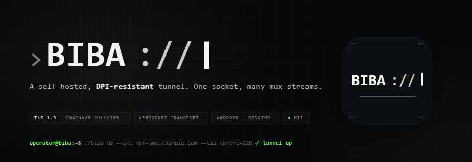

<p align="center">
  
</p>

<h1 align="center">BibaVPN</h1>

<p align="center">
  <strong>Your VPS. Your tunnel.</strong><br>
  A self-hosted Rust tunnel built to make traffic harder to classify.
</p>

<p align="center">
  <a href="https://github.com/Eljaja/BibaVPN/releases/latest"></a>
  <a href="LICENSE"></a>
  <a href="https://hub.docker.com/r/eljaja/bibavpn-server"></a>
</p>

<p align="center">
  <a href="#download"><strong>Download the app</strong></a> ·
  <a href="#quick-start">Quick start</a> ·
  <a href="#self-host-on-a-vps">Self-host</a> ·
  <a href="https://github.com/Eljaja/BibaVPN/discussions">Ask a question</a>
</p>

BibaVPN carries your apps' **SOCKS5 and HTTP CONNECT traffic over TLS + WebSocket** to a server you control. Bring one VPS, connect a client, and tune the tunnel for your network — with desktop and Android apps, encrypted invitations, and a Rust core you can inspect.


## Why BibaVPN?

- **Run your own exit server.** Host the server on a VPS you choose and manage your own credentials.
- **Connect with an invitation.** Import an encrypted `biba://` URI and enter its passphrase instead of copying a page of settings.
- **Work with the apps you already use.** Local SOCKS5 and optional HTTP CONNECT endpoints support browsers and proxy-aware tools; SOCKS5 UDP relay covers UDP traffic too.
- **Tune how the tunnel looks on the wire.** Adjust padding, timing jitter, decoy traffic and TLS profiles. Serve a camouflage website on the same TLS port.
- **Reuse connections.** Multiplex TCP streams across 1–4 WebSocket sessions, with a separate session for UDP relay.
- **Inspect and extend it.** MIT-licensed Rust client and server, a documented wire protocol, and shared desktop/Android app code.

## Download

**Already have an invitation?** Install a client, import your `biba://` URI, enter the passphrase, and connect. You need access to a BibaVPN server; the app does not include a hosted VPN subscription.

Newly minted invitations use Argon2id (invite format v2). Update clients before importing them; updated clients still accept existing v1 invitations.

| Platform | Download | Package |
| --- | --- | --- |
| Android | [Download APK](https://github.com/Eljaja/BibaVPN/releases/latest/download/BibaVPN-android-debug.apk) | ARM64 debug build; sideload |
| Windows | [Download ZIP](https://github.com/Eljaja/BibaVPN/releases/latest/download/BibaVPN-windows-x64.zip) | x64; extract before launching |
| macOS | [Download DMG](https://github.com/Eljaja/BibaVPN/releases/latest/download/BibaVPN-macos-aarch64.dmg) | Apple Silicon |
| Linux | [Choose a package](https://github.com/Eljaja/BibaVPN/releases/latest) | x86_64 AppImage or `.deb` |
| Server / CLI | [Quick server setup](#quick-start) · [Build from source](#build-from-source) | Self-hosted Rust binaries |


## Quick start

### Set up your own server

Connect to the VPS as root and run:

```bash
git clone https://github.com/eljaja/BibaVPN
bash start.sh
```

### Connect with an invitation

1. [Download the app](#download) and install it on your device.
2. Open **Settings**, paste the `biba://` invitation and its passphrase, then select **Apply to fields** and **Save**.
3. Select **Connect**. On Android, approve the VPN permission when prompted.

You need an invitation from a server administrator. To run your own server, follow the next section.


### Optional Yggdrasil mesh transport

For a server without mesh, run `bash start.sh` to pull the prebuilt server image and print an invitation. The script saves its generated secrets in `.biba-start.env`; keep this file private. Each run replaces the server credentials.

Pull and start the mesh-compatible server and mesh sidecar with a persistent Yggdrasil identity. The encrypted invitation includes its mesh address:

```bash
BIBA_INVITE_PUBLIC="your-server.example:8443" BIBA_INVITE_SNI="your-server.example" bash start.sh --mesh
```

`BIBA_YB_MESH=1 bash start.sh` is equivalent. Use `--no-mesh` to disable the sidecar. `BIBA_SERVER_IMAGE` and `BIBA_MESH_IMAGE` can override the image names. Mesh mode requires the published `eljaja/bibavpn-server:mesh` and `eljaja/bibavpn-yb-mesh:latest` images; these are published by the Docker workflow after the mesh changes reach the main branch.

Import the new invitation into an updated client and enable **biba://mash** on the connection screen. The setting belongs to the selected profile and is off by default. The server's `yb-mesh-data` Docker volume contains its identity: keep that volume when updating, since replacing it changes the mesh address and requires a new invitation. The sidecar shares the server container's network namespace and forwards its mesh port to the existing TLS listener; it needs no TUN device or inbound Yggdrasil port.

The client attempts several public TCP/TLS peers concurrently through Yggdrasil's reconnect logic. Available peers carry traffic and the mesh determines the route; this does not benchmark or guarantee the fastest route. There is no automatic fallback to the server's public address when mesh fails. For a custom client peer list, set `BIBA_YB_MESH_PEERS` to comma-separated TCP/TLS peer URLs in the client's environment. Public peers are third-party infrastructure, may disappear, and can observe the connection metadata of their direct links.

For existing deployments that mint invitations separately, set `BIBA_YB_MESH_ENDPOINT` to the sidecar address and port (for example `[201:…]:8443`) when running `bibavpn-server --print-invite-uri` or `bibavpn-mint-invite`. This does not install or start the sidecar by itself.

When minting an invitation with `bibavpn-mint-invite` for a self-signed server, set `INVITE_PIN_CERT_FILE` to the server certificate PEM to include the pin in the encrypted invitation. The sidecar forwards mesh port 8443 to port 8443 by default; set `BIBA_YB_MESH_FORWARD_PORT` on the sidecar if the existing server listens on a different port.

The secure Docker installer also accepts `BIBA_YB_MESH=1`. When using `scripts/deploy-secure-bibavpn-docker-remote.sh`, this additionally builds and transfers the sidecar image; when running `scripts/install-bibavpn-docker-secure.sh` directly on the VPS, load the `bibavpn-yb-mesh` image first. As with the existing installer, rerunning it replaces server credentials and certificates.

## How it works

```text
Your apps → BibaVPN client ═══ TLS + WebSocket ═══ Your VPS → Internet
             SOCKS5 /          secure tunnel    BibaVPN
           HTTP CONNECT                            server
```

## Configuration

Start with the defaults, then adjust only what your network needs. Run either binary with `--help` for its full option list; [AGENTS.md](AGENTS.md#transport-and-websocket-knobs) explains the transport controls.

| Goal | Options |
| --- | --- |
| Tune traffic shaping | `--stealth-profile`, `--pad-mode`, `--decoy-max`, `--max-pad`, `--idle-decoy-secs`, `--ws-jitter-min-ms`, `--ws-jitter-max-ms` |
| Use multiple TCP tunnel sessions | Client `--ws-parallel` (`1`–`4`) |
| Choose a TLS profile / engine | Client `--fingerprint`, `--tls-stack rustls\|boring`; BoringSSL requires a `boring-tls` build |
| Serve a camouflage site | Server `--camouflage-dir` or `--camouflage-url http://…`; private origins require `--camouflage-allow-private` |
| Adjust server timing | `--ack-profile`, `--server-ack-delay-min-ms`, `--server-ack-delay-max-ms`, `--rtt-mask-jitter-ms` |
| Pin the server certificate | Client `--pin-cert`; supported by both TLS engines |


The server and client must agree on token, PSK, WebSocket path and protocol domain (`--proto-domain`, default `default`). The default path is `/ws`; authentication credentials are carried inside the encrypted tunnel, not in the URL.


## Build from source

Clone the repository as shown in the [local Docker lab](#try-a-local-docker-lab). With Rust installed, run these commands from the repository root on Linux or WSL; `rust-toolchain.toml` selects the compiler:

```bash
cargo build --release -p bibavpn --bin bibavpn-server --bin bibavpn-client
cargo test -p bibavpn -p biba --locked
```

Optional BoringSSL client (also needs native build tools such as CMake and NASM):

```bash
cargo build --release -p bibavpn --features boring-tls --bin bibavpn-client
```

Then select `--tls-stack boring`. Desktop and mobile build instructions live in [apps/AGENTS.md](apps/AGENTS.md); the repository layout is in [AGENTS.md](AGENTS.md#repository-layout).

## Agent skill

The repository includes [bibavpn-setup](skills/bibavpn-setup/SKILL.md), a reusable Agent Skill for setup and connection troubleshooting. Codex and Claude Code can discover it from the project through the checked-in `.agents/skills/` and `.claude/skills/` links; start a new agent session after updating the repository. Other Agent Skills implementations can load or install the `skills/bibavpn-setup/` directory directly. If your Git checkout does not support symlinks, copy that directory into your agent's project skill directory instead.

## Security

BibaVPN is experimental software for people comfortable operating their own tunnel. It has **no third-party security audit** and makes no anonymity or universal DPI-bypass guarantee.

- Use verified TLS or pin the server certificate. `--insecure` is for local tests only.
- Keep tokens, PSKs, invitation passphrases and private keys out of Git and public reports. Rotate exposed credentials.
- Your VPS is the exit point: its operator can observe destinations and traffic metadata. End-to-end HTTPS still protects application contents; plaintext application traffic remains visible at the exit.
- `--legacy-path-auth` is a weaker compatibility mode; use the default authenticated tunnel instead.

Report vulnerabilities privately using [SECURITY.md](SECURITY.md).

## Help BibaVPN grow

**If BibaVPN is useful to you, give the repository a ⭐.** It helps other self-hosters discover the project and lets us know you want to see it grow.

You can also help without writing code: report how it behaves on your network, improve the setup instructions, or share it with someone who runs their own VPS. Remove secrets and identifying details from logs before posting.

- [Ask a question or share feedback](https://github.com/Eljaja/BibaVPN/discussions)
- [Report a bug](https://github.com/Eljaja/BibaVPN/issues) — include the version, platform, expected result and reproduction steps
- [Contribute a fix](CONTRIBUTING.md) — small, focused pull requests are welcome

## License

[MIT](LICENSE). Third-party components retain their own licenses.
